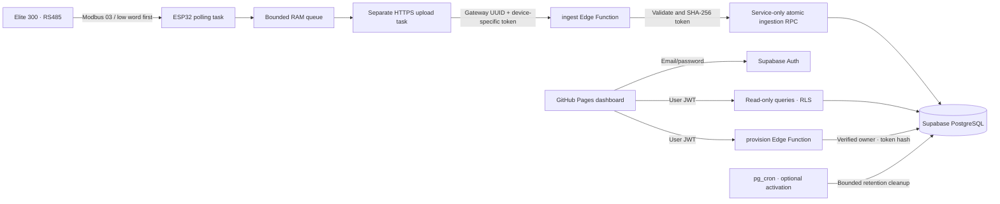

# Architecture and boundaries



## Identity and authorization

- A gateway belongs to exactly one `auth.users` owner. Meters have a UUID and a unique `(device_id,slave_id)` pair. A composite foreign key prevents a reading from referencing another gateway's meter.
- `devices`, `meters`, `readings`, `device_credentials`, and `retention_settings` all enable RLS. Browser roles receive SELECT only on the first three; anonymous roles receive no table access. Credentials and retention have no browser policy or grant. Sequence grants are also restricted.
- Browser query functions are **security invoker**. They retain RLS even for guessed UUIDs. All function execution grants are explicit. Browser users cannot invoke ingestion, provisioning writes, or cleanup directly through PostgREST.
- `provision` validates a real Auth session with the server's `auth.getUser(jwt)`, then passes that verified owner into a service-only RPC. The caller cannot supply an owner. Registration, meter addition, rotation and revocation serialize by owner; caps are 20 gateways/owner and 32 meters/gateway.
- Device tokens contain 256 random bits, encoded as `mg_` plus 64 hex digits. SHA-256 is appropriate for uniformly random high-entropy tokens, unlike human passwords. Only hashes are stored. Tokens are shown once and kept only in volatile UI state until the dialog closes. No session contains device credentials.
- `ingest` accepts no dashboard JWT as a substitute for a device token. `verify_jwt=false` permits device callers to reach the handler, which enforces the custom token itself. It does not enable public writes. The admin key exists only in the hosted function environment.
- Ingestion locks the gateway and its credential before checking revocation and rate limits. Rotate/revoke use the same gateway lock; an in-flight transaction completes before the change, and old-token transactions cannot start writing after the change commits.

## Ingestion contract

POST `/functions/v1/ingest`, `Content-Type: application/json`, `Authorization: Bearer mg_…`:

```json
{
  "device_id": "gateway-uuid",
  "samples": [{
    "sample_id": "random-v4-uuid",
    "slave_id": 1,
    "measured_at": null,
    "values": {"voltage_rn": 0, "frequency": null},
    "errors": {"frequency": "modbus_timeout"}
  }]
}
```

Measurements: `voltage_rn, voltage_yn, voltage_bn, voltage_avg, voltage_ry, voltage_yb, voltage_br, current_r, current_y, current_b, current_n, pf_r, pf_y, pf_b, pf_avg, frequency`. One sample is one meter and one row, never 16 separate inserts. Missing fields normalize to null plus `unavailable`. Value/error conflicts reject the request. Bounds of ±1e9 reject corrupt numeric extremes without pretending the installation is calibrated. All values remain in the meter's reported V/A/Hz/PF units; no undocumented multiplier is applied.

Payloads are streamed with a 64 KiB hard cap, batches 1–32, error strings ≤120 characters, slave IDs 1–247. A reliable supplied timestamp must be UTC ISO8601 with `Z`, within seven days past/five minutes future. Null/missing time is explicitly `clock_source=server`, `measured_at=NULL`; server received time always comes from the database. JSON numbers must be finite.

Each gateway may make one authenticated ingestion request per ten seconds, enforced transactionally across Edge instances. Invalid tokens never update the gateway's limiter. The unique `(device_id,sample_id)` constraint uses `ON CONFLICT DO NOTHING`: retrying cannot replace a prior reading. A successful response reports inserted and duplicate counts. IDs must not be reused for new measurements. The batch is atomic; a bad/unregistered meter rolls back all writes.

Responses: 200 acknowledged, 400 invalid schema/timestamp, 401 bad/revoked credentials, 403 unregistered meter, 405 method, 413 size, 415 content type, 429 rate limit (JSON `retry_after:10`), 503 backend failure. Internal errors and credentials are not echoed. ESP32 retries ambiguous/network/5xx responses with the same IDs. Provisioning accepts OPTIONS/POST, requires a verified user, and never writes during preflight.

Abuse limits bound each authenticated gateway's writes, registered devices, batch and query sizes. They do **not** provide a global pre-invocation/IP firewall: invalid requests may still consume Edge invocation quota. Protect tokens, monitor usage, revoke compromised devices, and use platform-supported traffic controls if necessary. No paid add-on is silently enabled.

## Queries, time, and state

Charts and filters use server received time consistently. Latest values are one indexed query per selected meter inside a single RPC (cap 32), ordered by received time and identity ID. Device time remains separate for audit. UI defaults to Asia/Thimphu (BTT, UTC+06:00), with UTC selectable and explicit labels. Custom date input is interpreted in the selected timezone. CSV timestamps remain labelled UTC ISO8601.

History is aggregated in PostgreSQL at 1m/5m/15m/1h/6h/1d resolution, selected to keep total rows under the 1,000 PostgREST limit (target ≤880 plus boundary buckets). Queries cap at 90 days; very large meter selections require shorter ranges. `generate_series` returns empty buckets as null. A missing single sample inside a larger bucket does not make the entire bucket null: the plotted value is the mean of available values. Fully missing/all-failed buckets leave gaps. No `connectNulls` and no zero-filling are used. Cards show the latest raw sample; selecting all meters labels cards as the first meter, while charts overlay all selected meters and health lists each separately.

CSV exports use server keyset pagination `(received_at,id)`, pages of 500, date windows ≤7 days and a 10,000-row browser cap. If the cap is exceeded the download fails explicitly without a truncated file. Choose narrower windows. No telemetry is editable through the dashboard.

Refresh is every 60 seconds while the tab is visible; status ages update every ten seconds. No Realtime subscriptions are created. Online means a sample is newer than the stale boundary; stale begins at the smaller of two minutes or half the offline threshold. Offline begins after the configurable threshold (default 5m, stored only in this browser), or for no-data/revoked gateways. This is **gateway delivery health**, not proof a meter's measurements are valid; the independent partial-reading indicator reports null/errors. Auth/network failures and empty history are explicit; quota errors remain visible with a retry action, never replaced with demo telemetry or fabricated zeros.
